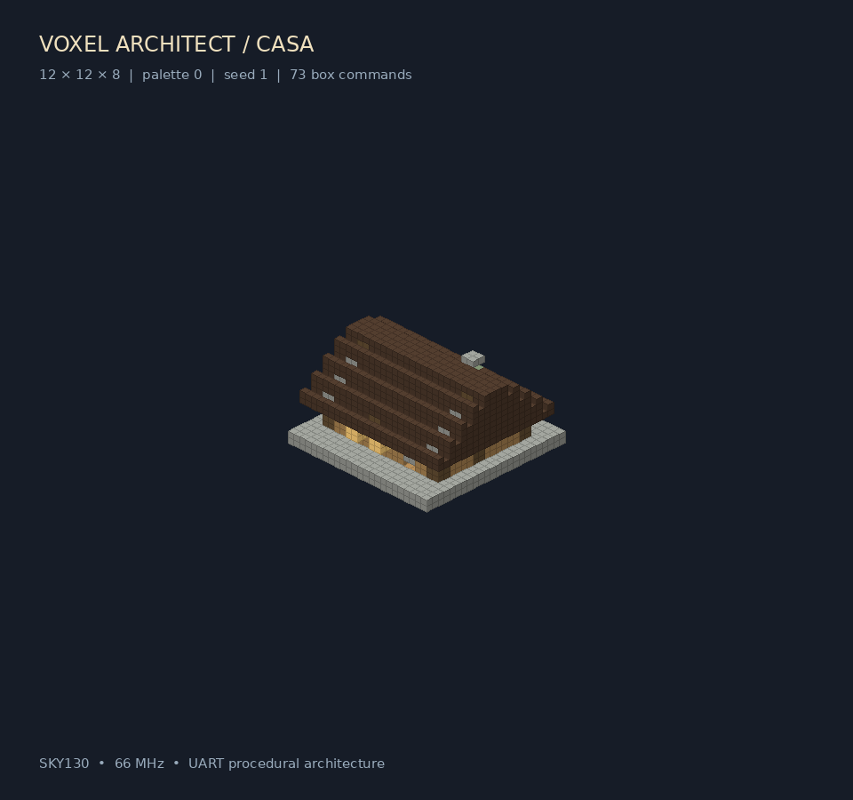
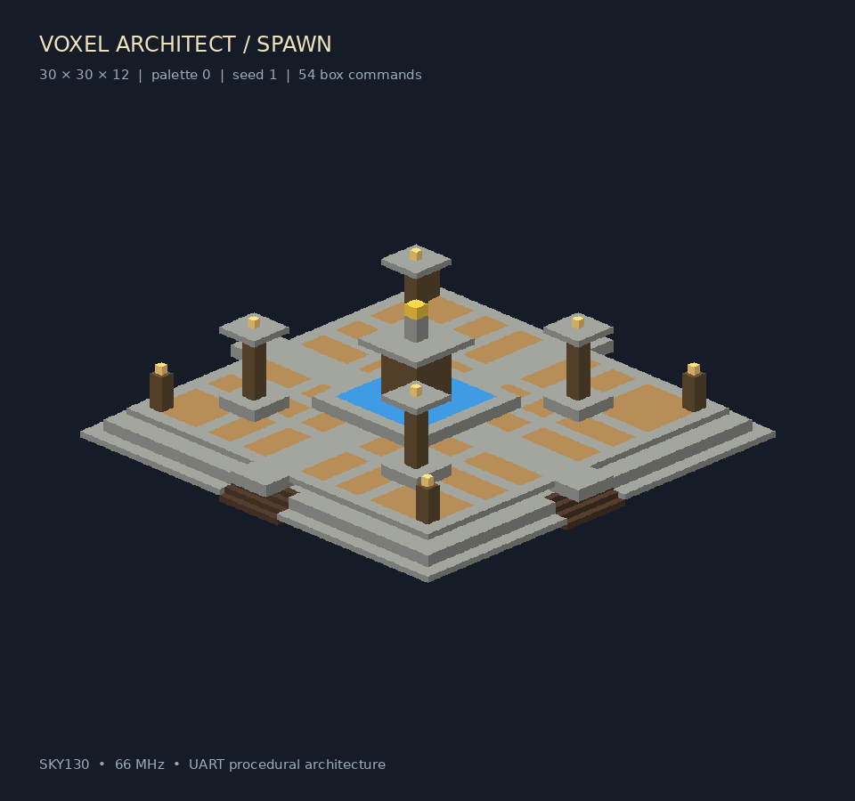
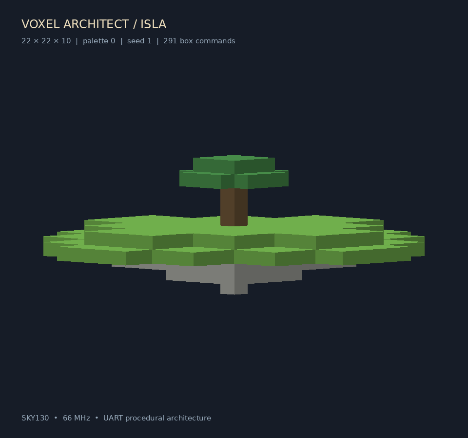

# Voxel Architect — Tiny Tapeout sky130

Procedural Minecraft Java architecture in synthesizable Verilog, targeting **66 MHz**.
Compatible with the original `puente_lan/bot_lan.js` line protocol. No external RAM or CPU.

```
BUILD 12 12 8 1 0
```

The chip replies with ordered `/fill` and `/setblock` commands, then `DONE`.
Five architectural programs × four material palettes; seeded texture and floating terrain.

| Casa | Spawn |
|---|---|
|  |  |
| Castillo | Templo |
|  |  |



These are schematic previews, not Minecraft screenshots. See [the datasheet](docs/info.md)
for pins, serial protocol, architecture, development commands and rendering limitations.
[The specification](docs/SPEC.md) is the source of truth.

## Development

* `src/`: standard TT top, UART RX/TX, streaming parser and generated expression/material/name ROM.
* `model/architect.py`: executable Python architectural programs and independent byte-stream evaluator.
* `tools/compile_rom.py`: regenerate ROM; `--check` verifies it is up to date.
* `tools/render.py --all`: command validation and isometric PNG previews.
* `test/`: cocotb byte-for-byte physical UART comparisons, including production clock/baud and GL mode.

```
python -m pip install -r test/requirements.txt
python tools/compile_rom.py --check
python -m unittest discover -s model -p 'test_*.py'
```

Run `make` in `test/` for the fast regression; `make REAL=yes` for a short complete build
at 66 MHz / 115200 baud. `make GATES=yes` uses the gate-level netlist supplied by TT CI.
The official template's GDS, test, documentation and FPGA workflows are retained.
