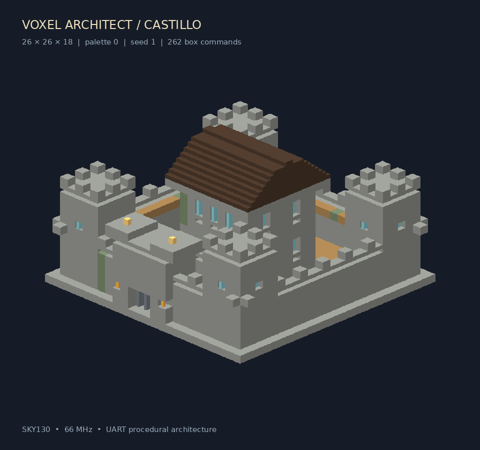
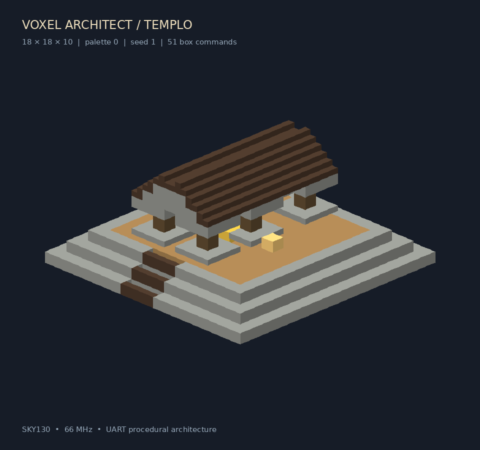

# Voxel Architect — Tiny Tapeout sky130

Procedural Minecraft Java architecture in synthesizable Verilog, targeting **66 MHz**.
Compatible with the original `puente_lan/bot_lan.js` line protocol. No external RAM or CPU.

```
BUILD 12 12 8 1 0
```

The chip replies with ordered `/fill` and `/setblock` commands, then `DONE`.
Five architectural programs × four material palettes; seeded texture and floating terrain.

Every box is streamed as disjoint tiles no larger than **32 × 32 × 32** (32,768 blocks),
including maximum-size builds. This respects Minecraft Java's default `/fill` limit
without changing the world's `commandModificationBlockLimit`. Tile ordering preserves
the original coarse-to-fine overwrite order.

The quality round raises house walls before the gable starts, seats the castle keep's roof
on a two-storey stone hall with window rows, sills and a corbel course, adds column
capitals and a trimmed temple pediment, and merges equal-height island terrain runs.
Default palette-0 command counts: **77 / 54 / 262 / 51 / 291** for
casa / spawn / castillo / templo / isla. At the bridge's 22×22×10 size the island has a
flat grass interior with a one-block lowered edge, a four-block-deep faceted stone cone,
three exposed trunk blocks and two rounded foliage layers. At height 14 the cone is six
blocks deep and the tree gains a fourth exposed trunk block and a third foliage layer
([taller preview](docs/img/isla-tall.png)); the build takes 327 commands.

| Casa | Spawn |
|---|---|
|  |  |
| Castillo | Templo |
|  |  |


These are schematic previews, not Minecraft screenshots. See [the datasheet](docs/info.md)
for pins, serial protocol, architecture, development commands and rendering limitations.
[The specification](docs/SPEC.md) is the source of truth.

## Development

* `src/`: standard TT top, UART RX/TX, streaming parser and generated expression/material/name ROM.
* `model/architect.py`: executable Python architectural programs and independent byte-stream evaluator.
* `tools/compile_rom.py`: regenerate ROM; `--check` verifies it is up to date.
* `tools/render.py --all`: command validation and isometric PNG previews.
* `test/`: cocotb byte-for-byte physical UART comparisons, including production clock/baud and GL mode.

```
python -m pip install -r test/requirements.txt
python tools/compile_rom.py --check
python -m unittest discover -s model -p 'test_*.py'
```

Run `make` in `test/` for the fast regression; `make REAL=yes` for a short complete build
at 66 MHz / 115200 baud. `make GATES=yes` uses the gate-level netlist supplied by TT CI.
The official template's GDS, test, documentation and FPGA workflows are retained.
Maximum 255³ builds for every archetype are validated without allocating a voxel grid;
physical-UART regressions compare a full 255³ house, a 255×255 platform and a 40³ house.
See [verification results](docs/verification.md) for synthesis comparisons and limitations.
Hardening is delegated to the PR's GitHub Actions `gds` job; do not start local hardening
on the two-core development box.
